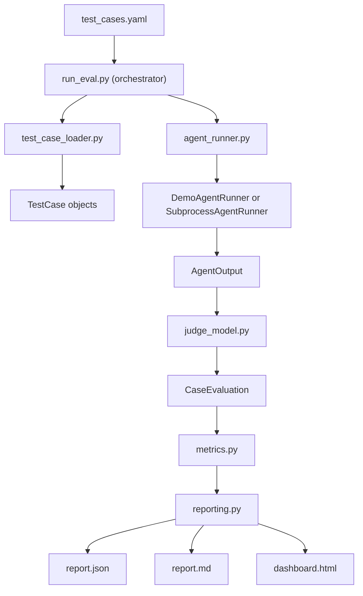
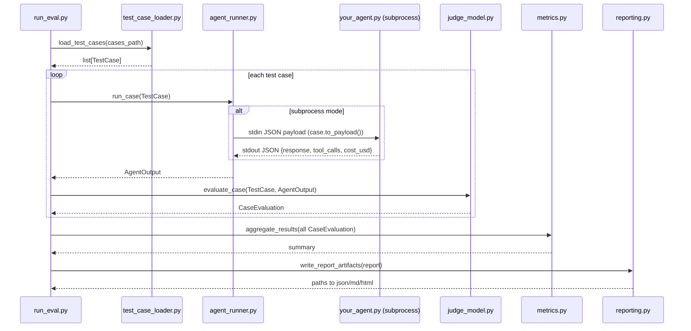

# LLM Eval Framework

Python app to evaluate incident-response agents against YAML test cases and produce JSON, Markdown, and HTML score dashboards.

## Architecture

### End-to-end flow



### Component communication contract



## What it includes

- `test_cases.yaml`: sample cases for incident triage, root cause detection, and log analysis
- `agent_runner.py`: demo runner plus subprocess adapter for a real agent
- `judge_model.py`: rule-based judge for accuracy, hallucination rate, latency, tool correctness, and cost
- `metrics.py`: aggregate metrics by model and category
- `reporting.py`: JSON, Markdown, and HTML report generation
- `run_eval.py`: CLI entry point

## Quick start

```bash
python3 -m venv .venv
source .venv/bin/activate
pip install -e .
llm-eval --cases test_cases.yaml
```

## Multi-model comparison (Phase 1)

Run multiple models in one evaluation by repeating `--model`:

```bash
llm-eval --cases test_cases.yaml --runner demo --model model-a --model model-b
```

Subprocess mode with per-model command override:

```bash
llm-eval --cases test_cases.yaml --runner subprocess \
  --model model-a="python3 agents/agent_a.py" \
  --model model-b="python3 agents/agent_b.py"
```

The generated JSON/Markdown/HTML reports now include a model leaderboard.

## Judge backend options (Phase 1)

Default deterministic judge:

```bash
llm-eval --cases test_cases.yaml --judge heuristic
```

Optional LLM-as-a-judge mode:

```bash
pip install -e ".[judge-deepeval]"
llm-eval --cases test_cases.yaml --judge deepeval
```

If DeepEval or required API credentials are unavailable, the pipeline falls back to
heuristic scoring and marks case results as `deepeval-fallback`.

## Use your own agent

Run the evaluator against a subprocess that reads a test-case payload on stdin and returns JSON on stdout:

```json
{
  "response": "Root cause is a bad deploy...",
  "tool_calls": ["metrics_api", "deploy_history"],
  "cost_usd": 0.014
}
```

Example:

```bash
llm-eval --runner subprocess --command "python3 path/to/your_agent.py" --model-name my-agent
```

Reports are written into `reports/<timestamp>/`.

## Next roadmap

- Phase 1 (Near term): Add multi-model comparison mode in one run (`--model` repeated flags) and leaderboard output in dashboard.
- Phase 1 (Near term): Replace heuristic judge with optional LLM-as-a-judge backend (DeepEval) while keeping deterministic fallback.
- Phase 2 (Mid term): Integrate LangSmith tracing for each case run and link trace URLs in `report.json`.
- Phase 2 (Mid term): Add TruLens feedback functions for faithfulness and safety risk scoring.
- Phase 3 (Later): Add CI mode (`--fail-threshold`) to block merges when accuracy drops or hallucination rises.
- Phase 3 (Later): Add scenario packs and regression snapshots for incident domains (payments, auth, infra, data pipeline).
